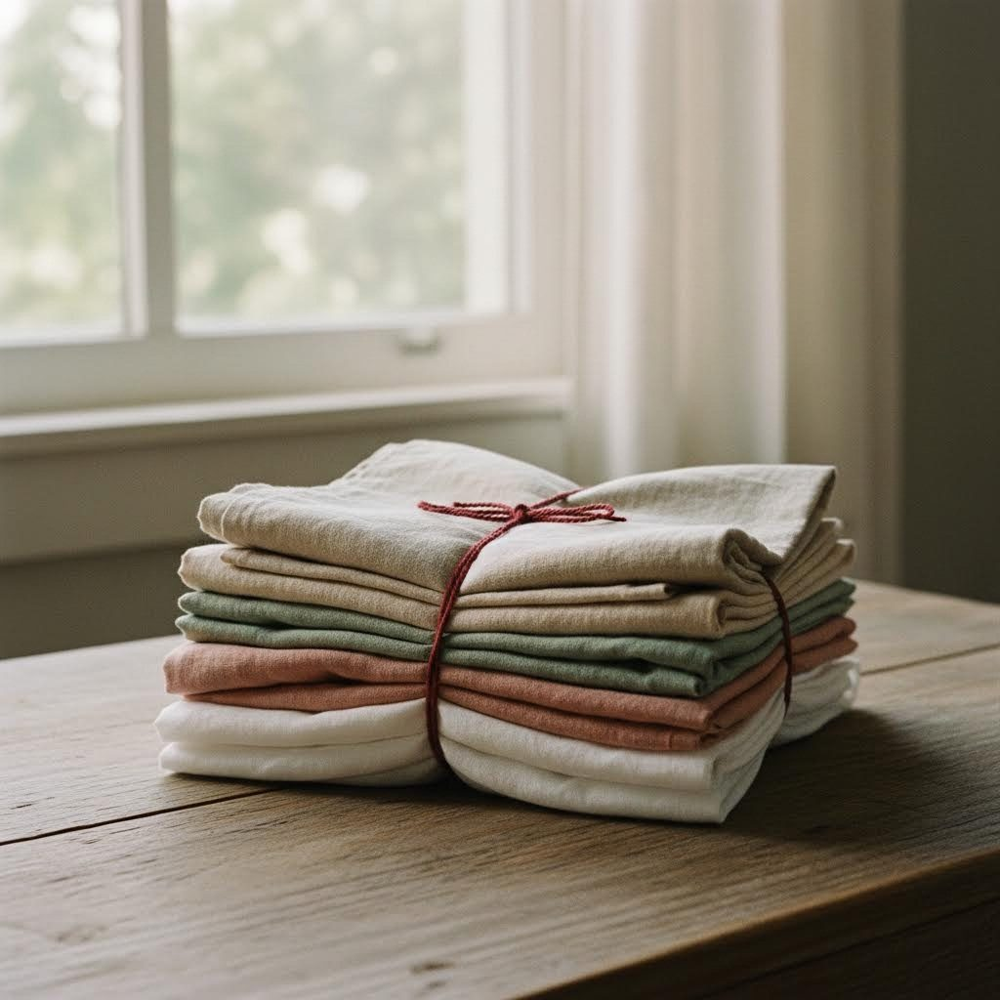

<b>In 30 seconds</b><ul><li>For a summer dress, choose <strong>mid-weight linen, about 150 to 200 gsm</strong>.</li><li>Pick <strong>washed or stonewashed</strong> linen if you want it soft from day one.</li><li>Buy about 10% extra and <strong>pre-wash</strong> it the way you will wash the dress.</li><li>Use a fresh 80/12 or 90/14 needle, finish every seam and press with steam.</li></ul>

Linen is breathable, gets softer with every wash and holds the shape of a boat neck or an A-line skirt beautifully. It is also easy to buy the wrong one: too fine and it turns see-through and limp, too heavy and your summer dress feels like a tablecloth. Here is how to choose well.

<figure class="g-photo"><figcaption>Washed linen in soft, easy-to-wear colours.</figcaption></figure>

## Step 1: understand linen weight

Fabric weight is listed as **gsm** (grams per square metre) or **oz per square yard**. It tells you more than anything else about how the dress will hang.

<figure class="g-fig"><svg viewBox="0 0 640 210" role="img" aria-label="Linen weight scale from light to heavy"><defs><linearGradient id="lw" x1="0" x2="1"><stop offset="0" stop-color="#F3E8CF"/><stop offset=".5" stop-color="#D9C7A6"/><stop offset="1" stop-color="#A88E66"/></linearGradient></defs><rect x="30" y="70" width="580" height="26" rx="13" fill="url(#lw)"/><g font-size="14" fill="#5E5A55" text-anchor="middle"><text x="60" y="122">100</text><text x="205" y="122">150</text><text x="350" y="122">200</text><text x="495" y="122">250</text><text x="590" y="122">gsm</text></g><rect x="190" y="62" width="180" height="42" rx="21" fill="none" stroke="#8A2822" stroke-width="3" stroke-dasharray="7 5"/><text x="280" y="50" font-size="15" font-weight="700" fill="#8A2822" text-anchor="middle">dresses and tops</text><g font-size="14" fill="#1A1717"><text x="40" y="160" font-weight="600">Light</text><text x="40" y="180" fill="#5E5A55">Blouses, linings,</text><text x="40" y="198" fill="#5E5A55">may need a slip</text><text x="245" y="160" font-weight="600">Medium</text><text x="245" y="180" fill="#5E5A55">Dresses, shirts,</text><text x="245" y="198" fill="#5E5A55">co-ord sets</text><text x="450" y="160" font-weight="600">Heavy</text><text x="450" y="180" fill="#5E5A55">Trousers, jackets,</text><text x="450" y="198" fill="#5E5A55">pinafores, aprons</text></g></svg><figcaption>Most of our linen dress patterns are happiest in medium weight.</figcaption></figure>

<table class="g-table"><thead><tr><th>Weight</th><th>Feels like</th><th>Sew it into</th></tr></thead><tbody><tr><td>Under 140 gsm</td><td>Light, airy, a little sheer</td><td>Blouses, gathered tops, sleeves. Hold it up to the light before buying.</td></tr><tr><td>150 to 200 gsm</td><td>Soft but solid, drapes well</td><td>Dresses, jumpsuits, shirts, skirts</td></tr><tr><td>Over 220 gsm</td><td>Sturdy, structured</td><td>Wide-leg trousers, jackets, pinafores</td></tr></tbody></table>

## Step 2: washed, stonewashed or plain?

- **Plain (unwashed) linen** is crisp and a little stiff, and it shrinks the most. It softens over time.
- **Washed or stonewashed linen** has already been pre-shrunk at the mill. It is soft, slightly crinkled and drapes from the first wear. For most dresses this is the one to pick.
- **Linen blends** with viscose or cotton wrinkle less, drape more and often cost less. Linen-viscose is lovely for swishy maxi skirts.

<b>Studio tip</b>
Scrunch a corner of the fabric in your fist for five seconds. If it comes out deeply creased and stays that way, it will look the same after you sit down in it. Washed linen and blends recover better.

## Step 3: work out how much to buy

Every pattern lists fabric requirements for each size and fabric width. Find your size, then add about **10%** to allow for shrinkage when you pre-wash. Linen usually comes 140 to 150 cm (55 to 60 in) wide.

## Step 4: pre-wash before you cut

Linen can shrink **3 to 10%**, mostly in length. If you skip this step, the first wash can turn a maxi into a midi.

<ol class="g-steps"><li>Zig-zag or overlock the cut ends so they don't fray in the machine.</li><li>Wash it the way you will wash the finished dress, usually 30 to 40 °C.</li><li>Dry it the same way too. If you will tumble dry the dress, tumble dry the fabric.</li><li>Press it while still slightly damp, then cut.</li></ol>

<figure class="g-duo"></figure>

## Step 5: sewing linen

<ul class="g-check"><li><strong>Needle:</strong> a fresh universal 80/12 for light and medium linen, 90/14 for heavy.</li><li><strong>Stitch length:</strong> 2.5 mm works well for most seams.</li><li><strong>Finish every seam:</strong> linen frays. Overlock, zig-zag, or use French seams on lighter linen.</li><li><strong>Stay-stitch curves:</strong> sew just inside the neckline and armholes before anything else so they don't stretch.</li><li><strong>Press with steam</strong> after every seam, on the linen setting.</li></ul>

## Mistakes we see most

Cutting linen straight off the rollPre-wash and dry it first

Very light linen for a fitted dress150 to 200 gsm, or add a lining

Leaving raw edges insideFinish every seam: linen frays

Pressing on a dry, low heatHigh heat with plenty of steam

## Caring for your linen dress

Wash at 30 to 40 °C, avoid overloading the machine, and line dry in the shade. Iron while slightly damp, or simply embrace the relaxed creases. That lived-in look is half of linen's charm.
