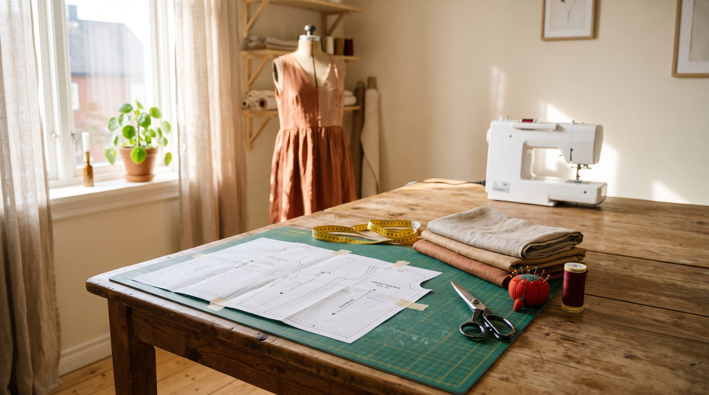

<b>In 30 seconds</b><ol><li>Open the PDF in Adobe Acrobat Reader, not your browser.</li><li>Print at <strong>Actual size / 100%</strong>, with every "fit" option turned off.</li><li>Print the test page first and measure the square.</li><li>If the square is right, print the rest, trim, match and tape.</li></ol>

A PDF sewing pattern is only as accurate as your print. Print it 3% too small and a dress drafted for your measurements comes out almost a full size smaller around the bust. The good news: getting it right takes one setting and one measurement, and once you have done it you never have to think about it again.

<figure class="g-photo"><figcaption>A taped PDF pattern, ready for cutting.</figcaption></figure>

## Step 1: pick the file that suits you

Each pattern comes with more than one print file, and you only need one of them.

<table class="g-table"><thead><tr><th>File</th><th>Paper</th><th>Best for</th></tr></thead><tbody><tr><td><strong>A4</strong></td><td>21 × 29.7 cm, standard outside North America</td><td>Home printers in the UK, Europe, Australia, India and most of the world</td></tr><tr><td><strong>US Letter</strong></td><td>8.5 × 11 in</td><td>Home printers in the US and Canada</td></tr><tr><td><strong>A0</strong></td><td>One big sheet, about 84 × 119 cm</td><td>Copy shops and print services. No taping at all</td></tr></tbody></table>

Not sure which paper is in your printer? Check the paper packet. If it says 210 × 297 mm it is A4, if it says 8.5 × 11 in it is US Letter.

## Step 2: set your printer to actual size

This is the one setting that matters. Open the PDF in a free reader such as **Adobe Acrobat Reader**. Web browsers and phone previews sometimes rescale pages quietly, so avoid printing straight from them.

<figure class="g-fig"><svg viewBox="0 0 640 300" role="img" aria-label="Print dialog with Actual size selected and Fit turned off"><rect x="10" y="10" width="620" height="280" rx="14" fill="#fff" stroke="#1A1717" stroke-width="2"/><rect x="10" y="10" width="620" height="44" rx="14" fill="#1A1717"/><text x="34" y="39" fill="#F6F1E9" font-size="17" font-weight="600">Print</text><text x="40" y="92" font-size="16" font-weight="600" fill="#1A1717">Page sizing &amp; handling</text><rect x="40" y="110" width="120" height="40" rx="8" fill="#F6F1E9" stroke="#C9BFB2"/><text x="64" y="136" font-size="15" fill="#5E5A55">Fit</text><rect x="172" y="110" width="150" height="40" rx="8" fill="#1A1717"/><text x="192" y="136" font-size="15" fill="#fff" font-weight="600">Actual size</text><rect x="334" y="110" width="200" height="40" rx="8" fill="#F6F1E9" stroke="#C9BFB2"/><text x="352" y="136" font-size="15" fill="#5E5A55">Shrink oversized pages</text><text x="40" y="190" font-size="16" font-weight="600" fill="#1A1717">Scale</text><rect x="110" y="168" width="90" height="36" rx="8" fill="#fff" stroke="#1A1717" stroke-width="2"/><text x="132" y="192" font-size="16" font-weight="700" fill="#1A1717">100 %</text><text x="40" y="244" font-size="16" font-weight="600" fill="#1A1717">Orientation</text><text x="150" y="244" font-size="15" fill="#5E5A55">Portrait (unless the file says otherwise)</text><rect x="164" y="102" width="166" height="56" rx="12" fill="none" stroke="#8A2822" stroke-width="3" stroke-dasharray="6 5"/><rect x="102" y="160" width="106" height="52" rx="12" fill="none" stroke="#8A2822" stroke-width="3" stroke-dasharray="6 5"/></svg><figcaption>Names vary a little between printers, but look for "Actual size" or a scale of 100%.</figcaption></figure>

<ol class="g-steps"><li>Choose <strong>Actual size</strong>, or set the scale to <strong>100%</strong>.</li><li>Turn off <strong>Fit to page</strong>, <strong>Shrink oversized pages</strong> and anything that says "scale to fit".</li><li>Print in portrait unless the pattern says otherwise.</li><li>Colour or black and white is up to you. Black and white saves ink and the lines are still clear.</li></ol>

## Step 3: print the test page and measure the square

Every pattern has a test square, a small box with its exact size printed beside it, for example 4 × 4 in or 10 × 10 cm. Print **only that page** first, then measure it with a ruler.

<figure class="g-fig"><svg viewBox="0 0 640 260" role="img" aria-label="Measuring the test square with a ruler"><rect x="40" y="30" width="200" height="200" fill="#FFFDF9" stroke="#1A1717" stroke-width="3"/><text x="140" y="125" font-size="20" font-weight="700" fill="#1A1717" text-anchor="middle">4" × 4"</text><text x="140" y="152" font-size="15" fill="#5E5A55" text-anchor="middle">10.16 × 10.16 cm</text><rect x="30" y="236" width="230" height="20" fill="#F5D76E" stroke="#B8941F"/><g stroke="#1A1717" stroke-width="1.5"><path d="M40 236v12M90 236v8M140 236v12M190 236v8M240 236v12"/></g><path d="M300 70h150" stroke="#2F6656" stroke-width="3"/><text x="300" y="58" font-size="16" fill="#2F6656" font-weight="600">Square matches?</text><text x="300" y="100" font-size="15" fill="#5E5A55">Print every page.</text><path d="M300 170h150" stroke="#8A2822" stroke-width="3"/><text x="300" y="158" font-size="16" fill="#8A2822" font-weight="600">Off by even 2 mm?</text><text x="300" y="200" font-size="15" fill="#5E5A55">Recheck the scale, then print again.</text></svg><figcaption>Measure both sides of the square. A small error on one page adds up across a whole skirt panel.</figcaption></figure>

<b>Studio tip</b>
Measure the square in both directions. If one side is right and the other is short, your printer is shrinking the page in one direction. Turning off "borderless" printing usually fixes it.

## Step 4: lay out the pages and tape them

Lay every page on the floor or a big table in order. Patterns number their pages or use a grid of rows and columns, and they print small markers on the edges so you know which pages meet.

<figure class="g-fig"><svg viewBox="0 0 640 300" role="img" aria-label="Pages laid in a grid with matching markers"><g font-size="14" fill="#5E5A55" text-anchor="middle"><rect x="40" y="20" width="134" height="84" fill="#FFFDF9" stroke="#1A1717" stroke-width="1.5"/><text x="107" y="68">A1</text><rect x="180" y="20" width="134" height="84" fill="#FFFDF9" stroke="#1A1717" stroke-width="1.5"/><text x="247" y="68">A2</text><rect x="320" y="20" width="134" height="84" fill="#FFFDF9" stroke="#1A1717" stroke-width="1.5"/><text x="387" y="68">A3</text><rect x="460" y="20" width="134" height="84" fill="#FFFDF9" stroke="#1A1717" stroke-width="1.5"/><text x="527" y="68">A4</text><rect x="40" y="110" width="134" height="84" fill="#FFFDF9" stroke="#1A1717" stroke-width="1.5"/><text x="107" y="158">B1</text><rect x="180" y="110" width="134" height="84" fill="#FFFDF9" stroke="#1A1717" stroke-width="1.5"/><text x="247" y="158">B2</text><rect x="320" y="110" width="134" height="84" fill="#FFFDF9" stroke="#1A1717" stroke-width="1.5"/><text x="387" y="158">B3</text><rect x="460" y="110" width="134" height="84" fill="#FFFDF9" stroke="#1A1717" stroke-width="1.5"/><text x="527" y="158">B4</text><rect x="40" y="200" width="134" height="84" fill="#FFFDF9" stroke="#1A1717" stroke-width="1.5"/><text x="107" y="248">C1</text><rect x="180" y="200" width="134" height="84" fill="#FFFDF9" stroke="#1A1717" stroke-width="1.5"/><text x="247" y="248">C2</text><rect x="320" y="200" width="134" height="84" fill="#FFFDF9" stroke="#1A1717" stroke-width="1.5"/><text x="387" y="248">C3</text><rect x="460" y="200" width="134" height="84" fill="#FFFDF9" stroke="#1A1717" stroke-width="1.5"/><text x="527" y="248">C4</text></g><path d="M80 250 C160 120 260 230 340 90 S520 60 560 220" stroke="#8A2822" stroke-width="3" fill="none"/><g fill="#8A2822"><path d="M174 62 l8 -8 l0 16 z"/><path d="M314 62 l8 -8 l0 16 z"/><path d="M454 62 l8 -8 l0 16 z"/></g></svg><figcaption>Match the page markers so the pattern lines run straight across every join.</figcaption></figure>

<ol class="g-steps"><li>Trim or fold under the right edge and the bottom edge of each page. Leave the top and left untouched.</li><li>Overlap each page onto its neighbour so the markers meet exactly.</li><li>Tape across the join with small pieces of clear tape, roughly every 8 cm.</li><li>Tape one row at a time, then join the rows together.</li></ol>

Plan on 15 to 30 minutes for a dress. It goes faster than you think once the first row is done.

## Step 5: cut your size, or trace it

Each size has its own line, usually its own colour or dash style. You can cut straight along your size, or trace it onto tracing paper so you keep every size for later. Tracing is worth it if you are between sizes, sewing for someone else, or plan to make the pattern again.

## Mistakes we see most

Printing from the browser previewDownload the file and open it in Acrobat Reader

Leaving "Fit to page" switched onChoose Actual size or 100%

Printing all 40 pages before checkingPrint and measure the test page first

Taping pages slightly crookedMatch the markers, not the paper edges

## Printing at a copy shop

No printer, a big pattern, or you simply hate taping? Send the **A0 file** to a local copy shop or an online print service and ask for it printed **at 100%, black and white, on plain paper**. It usually costs a few dollars a sheet and you get the whole pattern in one piece.

## Your printing checklist

<ul class="g-check"><li>Downloaded the right file: A4, US Letter or A0</li><li>Opened it in Acrobat Reader</li><li>Set to Actual size / 100%, with Fit turned off</li><li>Printed the test page and the square measures correctly</li><li>Pages trimmed, matched and taped</li><li>Your size marked or traced before cutting</li></ul>