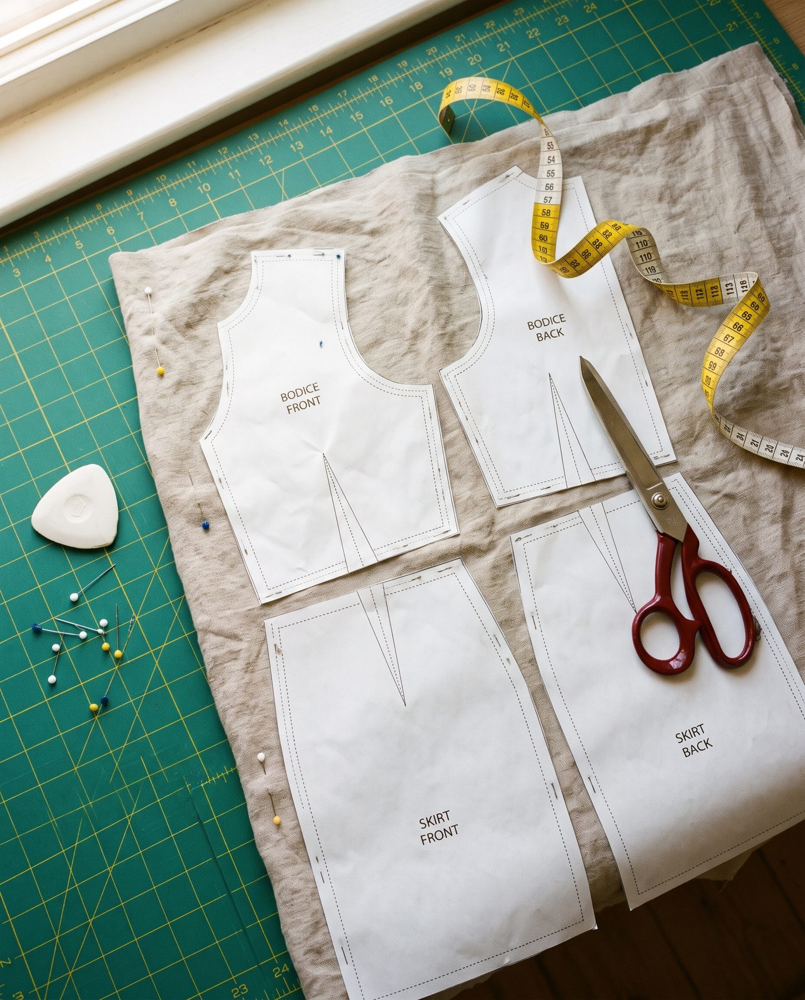
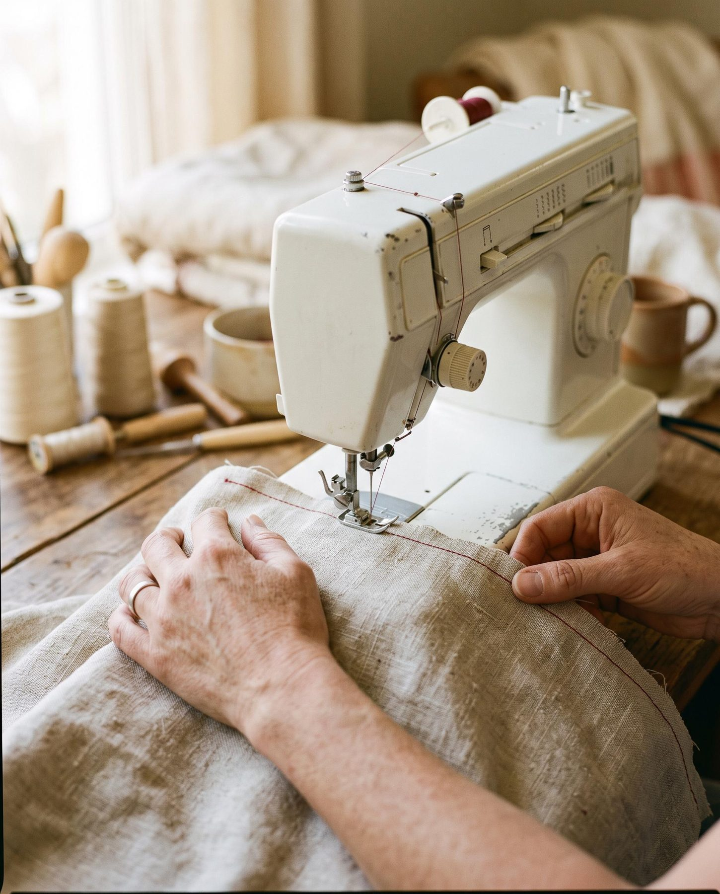
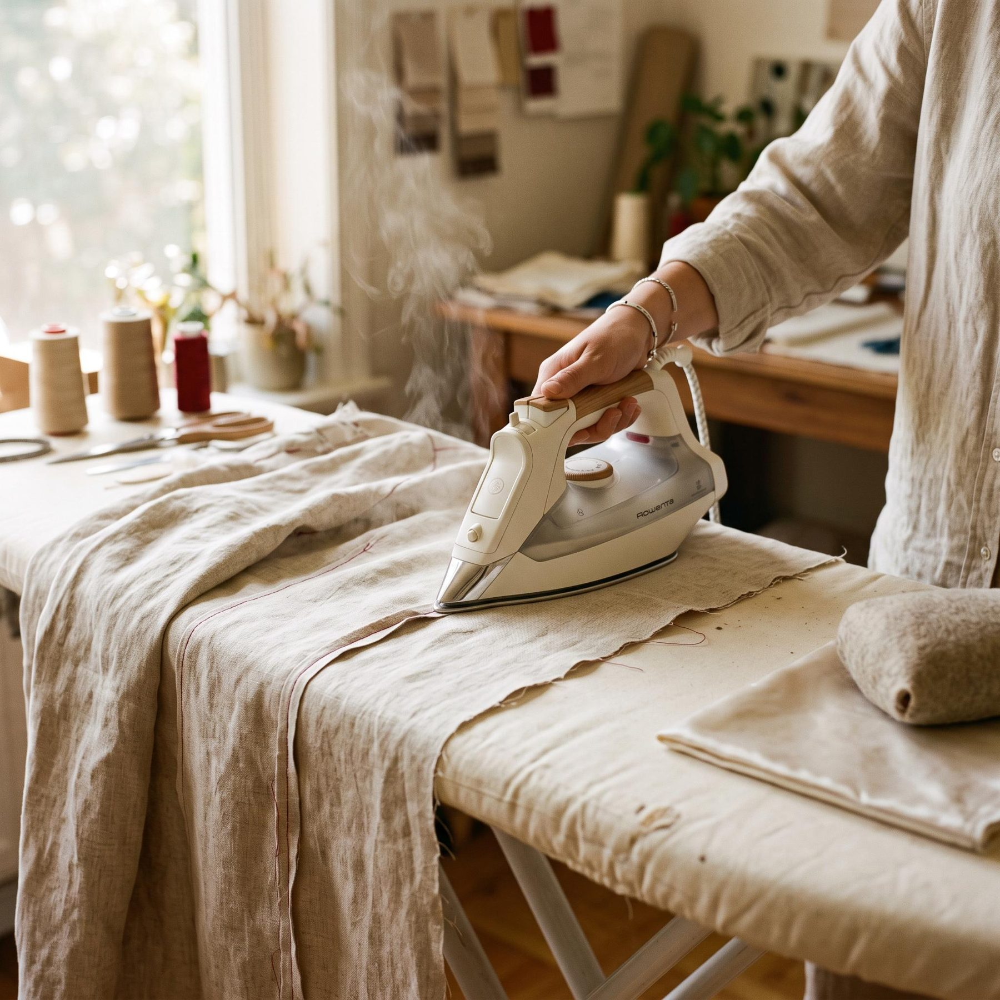

<b>In 30 seconds</b><ul><li><strong>For printing:</strong> a home printer (or a copy shop), clear tape and paper scissors.</li><li><strong>For cutting:</strong> sharp fabric scissors, pins or clips and a soft tape measure.</li><li><strong>For sewing:</strong> any straight-stitch and zig-zag machine, the right needle and good thread.</li><li><strong>For finishing:</strong> an iron, a seam ripper and a marking pen.</li></ul>

You don't need a room full of gadgets to sew from a PDF pattern. This is the short list that covers almost every pattern in our shop, plus the extras worth adding once you are hooked.

<figure class="g-photo"><figcaption>Almost everything on this list fits on one cutting mat.</figcaption></figure>

## For printing and taping

<ul class="g-check"><li><strong>A printer</strong> that prints A4 or US Letter. Any basic inkjet or laser works. No printer? Use the A0 file at a copy shop.</li><li><strong>Clear tape</strong>, ideally in a dispenser. You will use a lot of it.</li><li><strong>Paper scissors</strong>, kept separate from your fabric scissors.</li><li><strong>A ruler</strong> to measure the test square.</li></ul>

## For measuring and cutting

<ul class="g-check"><li><strong>Fabric scissors.</strong> 20 to 25 cm (8 to 10 in) blades. Use them only on fabric; paper blunts them.</li><li><strong>A soft tape measure</strong> for your body measurements and for checking the pattern.</li><li><strong>Pins or sewing clips.</strong> Glass-head pins don't melt under the iron. Clips are kinder to slippery or thick fabric.</li><li><strong>Pattern weights.</strong> Tins of food work perfectly and stop the paper sliding.</li><li><strong>A marking tool:</strong> tailor's chalk or a washable fabric pen for darts and notches.</li></ul>

<b>Studio tip</b>
Tie a ribbon round the handle of your fabric scissors. Everyone in the house will know they are off limits for paper, tape and packaging.

## For sewing

<ul class="g-check"><li><strong>A sewing machine</strong> with straight stitch and zig-zag. That is all most patterns need. A buttonhole stitch is a bonus.</li><li><strong>Machine needles:</strong> universal 80/12 for most wovens, ballpoint or jersey needles for knits. Change the needle every 8 to 10 hours of sewing.</li><li><strong>Polyester all-purpose thread</strong> in a colour matching your fabric. Cheap thread snaps and leaves fluff in the machine.</li><li><strong>A seam ripper.</strong> Every sewist uses one. It is part of sewing, not a sign of failure.</li></ul>

## For pressing

<ul class="g-check"><li><strong>An iron with steam</strong> and an ironing board.</li><li><strong>A pressing cloth</strong>, any thin cotton tea towel, to protect delicate or dark fabrics from shine.</li></ul>

<figure class="g-duo"></figure>

## Nice to have, later

<table class="g-table"><thead><tr><th>Tool</th><th>Why it helps</th></tr></thead><tbody><tr><td>Rotary cutter and cutting mat</td><td>Fast, accurate cutting, especially on slippery fabric</td></tr><tr><td>Overlocker (serger)</td><td>Neat, professional seam finishes in one step</td></tr><tr><td>Tailor's ham</td><td>Pressing curved seams like bust darts and princess seams</td></tr><tr><td>Tracing paper</td><td>Keep every size of your pattern for next time</td></tr><tr><td>Walking foot</td><td>Stops knits and layered fabrics from shifting</td></tr></tbody></table>

## Mistakes we see most

Cutting paper with fabric scissorsTwo pairs: one for paper, one for fabric

Using the same needle for monthsA fresh needle every 8 to 10 hours

Skipping the ironPress every seam as you sew

Buying a big gadget kit firstStart with this list and add as you go

## Your first-project checklist

<ul class="g-check"><li>Pattern printed and taped, test square checked</li><li>Fabric pre-washed and pressed</li><li>Fabric scissors, pins or clips and weights ready</li><li>Fresh needle in the machine and matching thread wound</li><li>Iron switched on next to the machine</li></ul>
