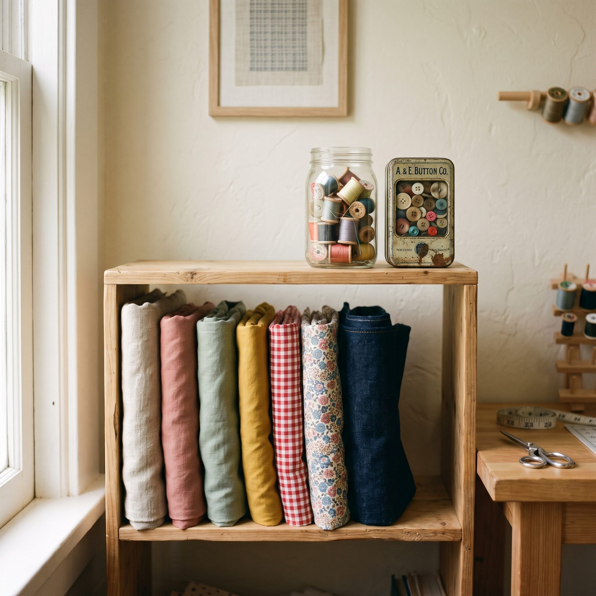

<b>In 30 seconds</b><ul><li>Every pattern says whether it is drafted for <strong>woven</strong> or <strong>knit</strong> fabric. Follow it.</li><li><strong>Woven</strong> fabric has little or no stretch and frays at the edges.</li><li><strong>Knit</strong> fabric stretches, doesn't fray and often curls at the edges.</li><li>Wovens: universal needle and straight stitch. Knits: ballpoint needle and a stretch or narrow zig-zag stitch.</li></ul>

Every pattern in our shop says whether it is drafted for **woven** or **knit** fabric. It is one of the most important lines in the pattern, because the two behave completely differently, and the pattern pieces are shaped around that behaviour.

<figure class="g-photo"><figcaption>Linen, cotton and gingham are wovens. T-shirt jersey and rib are knits.</figcaption></figure>

## How they are made

<figure class="g-fig"><svg viewBox="0 0 640 250" role="img" aria-label="Woven threads cross over and under; knit fabric is made of loops"><g transform="translate(40 30)"><rect width="230" height="170" rx="12" fill="#F3E8CF"/><g stroke="#8A2822" stroke-width="10" stroke-linecap="round"><path d="M20 30h190M20 70h190M20 110h190M20 150h190"/></g><g stroke="#2F6656" stroke-width="10" stroke-linecap="round" opacity=".85"><path d="M40 15v140M85 15v140M130 15v140M175 15v140"/></g><text x="115" y="200" font-size="17" font-weight="700" fill="#1A1717" text-anchor="middle">Woven</text><text x="115" y="220" font-size="13" fill="#5E5A55" text-anchor="middle">threads cross over and under</text></g><g transform="translate(370 30)"><rect width="230" height="170" rx="12" fill="#E8E2E6"/><g fill="none" stroke="#1A1717" stroke-width="3"><path d="M20 50c10-30 30-30 30 0s20 30 30 0 20-30 30 0 20 30 30 0 20-30 30 0 20 30 30 0"/><path d="M20 90c10-30 30-30 30 0s20 30 30 0 20-30 30 0 20 30 30 0 20-30 30 0 20 30 30 0"/><path d="M20 130c10-30 30-30 30 0s20 30 30 0 20-30 30 0 20 30 30 0 20-30 30 0 20 30 30 0"/></g><text x="115" y="200" font-size="17" font-weight="700" fill="#1A1717" text-anchor="middle">Knit</text><text x="115" y="220" font-size="13" fill="#5E5A55" text-anchor="middle">one thread looped into rows</text></g></svg><figcaption>Loops can open up and spring back. That is why knits stretch.</figcaption></figure>

## Woven fabric

Made from two sets of threads crossing over and under each other, like a basket. Woven fabric has little or no stretch (unless elastane is added), it frays at the cut edge, and it holds crisp shapes: collars, pleats, structured waistbands.

**Examples:** linen, cotton poplin, chambray, denim, gingham, rayon challis, crepe, satin.

**Patterns drafted for wovens** have zips, buttons, darts or wrap fronts, because the fabric can't stretch over your head or shoulders.

## Knit fabric

Made from a single thread looped into rows, like a hand-knitted jumper on a tiny scale. Knits stretch, recover their shape, don't fray, and often curl at the cut edge.

**Examples:** cotton jersey, rib knit, French terry, sweatshirt fleece, ponte, interlock.

**Patterns drafted for knits** usually have no zip or buttons and less ease, because the fabric stretches to fit your body.

## How to tell them apart in 10 seconds

<ol class="g-steps"><li><strong>Stretch it across the width.</strong> A knit stretches easily and springs back. A woven barely moves.</li><li><strong>Look at the cut edge.</strong> Threads fraying off? Woven. Edge rolling up neatly? Probably knit.</li><li><strong>Look closely at the surface.</strong> Tiny V shapes in rows mean knit. A criss-cross grid means woven.</li></ol>

## Testing stretch for knit patterns

Knit patterns often say how much stretch they need, for example "40% stretch". Here is how to test a fabric:

<ol class="g-steps"><li>Fold the fabric along the width and mark 10 cm (4 in) along the fold.</li><li>Hold the marks and gently stretch, without straining it.</li><li>If 10 cm stretches comfortably to 14 cm, the fabric has 40% stretch.</li><li>Let go. It should spring back to 10 cm. If it stays baggy, its recovery is poor.</li></ol>

<b>Studio tip</b>
Fabric with less stretch than the pattern asks for will fit tighter, sometimes too tight to pull on. More stretch fits looser. When in doubt, test a little more than the pattern says, not less.

## Needles and stitches

<table class="g-table"><thead><tr><th></th><th>Woven</th><th>Knit</th></tr></thead><tbody><tr><td>Needle</td><td>Universal 80/12, Microtex for fine fabrics</td><td>Ballpoint or jersey 75/11 to 80/12, stretch needle for spandex</td></tr><tr><td>Seam stitch</td><td>Straight stitch, 2.5 mm</td><td>Narrow zig-zag, stretch stitch or overlocker</td></tr><tr><td>Seam finish</td><td>Overlock, zig-zag or French seams</td><td>Often none needed, knits don't fray</td></tr><tr><td>Hem</td><td>Double-fold hem</td><td>Twin needle or zig-zag, so the hem can stretch</td></tr></tbody></table>

## Can you swap them?

- **Knit pattern in a woven fabric:** usually no. Without stretch it will be too tight and may not go over your head.
- **Woven pattern in a knit fabric:** sometimes, for loose styles. Expect a softer, looser fit, and skip any zip.

## Mistakes we see most

Sewing jersey with a universal needleBallpoint needle, no skipped stitches

Straight stitch on knit seamsNarrow zig-zag so seams can stretch

Ignoring the stretch percentageTest 10 cm before you buy

Stretching knit as you sewLet the machine feed it, use a walking foot

Want to know more about a particular fabric? The [Fabric library](../../fabrics/) covers 16 of them, with drape, stretch and needle notes for each.
